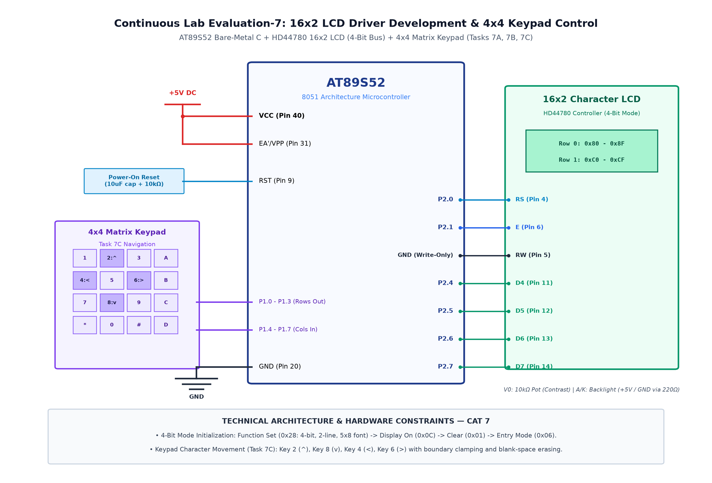

# CAT 7: 16x2 LCD Driver Development & Interactive Display

## Experiment Overview
- **Target Platform:** AT89S52 Microcontroller Development Board @ 11.0592 MHz
- **Objective:** Develop a standalone 4-bit parallel driver for the HD44780 16x2 character LCD, position the cursor, display dynamic numerical counters, and build an interactive menu controlled by a 4x4 keypad.

---

## Active Subtasks
- 📁 **[TASK 7A: LCD 4-Bit Driver & Dual-Row Display](TASK7A/)**: 4-bit LCD initialization and static string display on both rows.
- 📁 **[TASK 7B: Cursor Positioning & Dynamic Counter Display](TASK7B/)**: Incrementing numerical counter updating dynamically on Line 2.
- 📁 **[TASK 7C: 4x4 Keypad Interactive LCD Menu Navigation](TASK7C/)**: Real-time keypad input reading and character/menu rendering on LCD.

---

## Working Principle & 4-Bit Interfacing
1. **4-Bit Mode Operation:** Saves 4 microcontroller pins by splitting each 8-bit command or data byte into two 4-bit nibbles (higher nibble first, then lower nibble) strobed using the Enable (`EN`) pin.
2. **Control Signals:**
   - `RS = 0`: Command register (clear screen, set cursor address).
   - `RS = 1`: Data register (display character on screen).
   - `EN`: High-to-low pulse latches the 4-bit data on `D4`–`D7`.
3. **Line Addressing:** Row 0 starts at DDRAM address `0x80`, and Row 1 starts at `0xC0`.

---

## Circuit Diagram

---

## Summary & Inferences
1. 4-bit interfacing successfully reduces required LCD I/O pins from 11 to 6.
2. Dynamic counter values were converted from integers to ASCII characters and updated smoothly.
3. Keypad input provided interactive control over the LCD display in real time.
